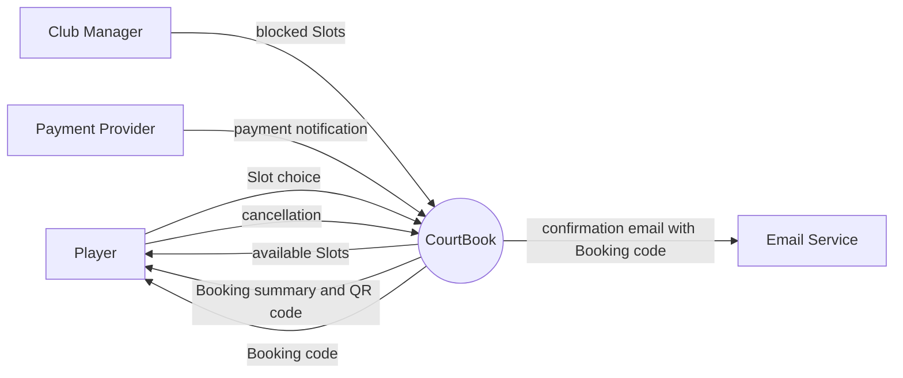
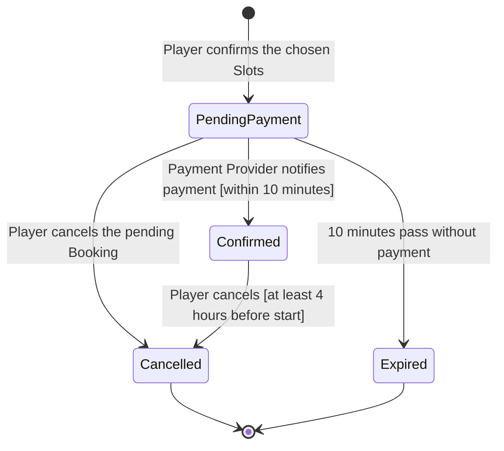

# Models: CourtBook

| Item | Value |
|---|---|
| Product | CourtBook |
| Version | 0.1 |
| Author | BA Team |
| Date | 2026-10-13 |

## Revision History

| Name | Date | Reason for changes | Version |
|---|---|---|---|
| BA Team | 2026-10-13 | First draft: context diagram and Booking states | 0.1 |

## Context Diagram

Figure 1 shows the boundary of CourtBook and the data that crosses it. The Player pays the Payment Provider directly. CourtBook only receives the payment notification.

Figure 1. Context diagram for CourtBook, release 1.0
Key: circle = the system. Rectangle = external entity. Arrow = flow of data.

## State Diagram of a Booking

Figure 2 shows the states of one Booking and the events that change them. The sources are UC-1 and BR-4, BR-7.

Figure 2. States of a Booking
Key: box = state. Arrow = allowed change, labelled with its cause. Pending payment is `PendingPayment`.

| State | Slots | Meaning |
|---|---|---|
| Pending payment | Held | The Player has 10 minutes to pay (BR-4). |
| Confirmed | Booked | The Booking has a Booking code (UC-1 POST-1). |
| Cancelled | Released | The Player cancelled the Booking. |
| Expired | Released | The Player did not pay in time. |

## Open Questions

| ID | Question | Owner |
|---|---|---|
| Q-1 | What happens when the Player cancels a Confirmed Booking less than 4 hours before the start? BR-7 gives the free window only. | Club Manager |
| Q-2 | Does a Confirmed Booking have a final state after its end time, for example Completed? No source names one. | Club Manager |
| Q-3 | What happens to a Confirmed Booking when the Club Manager blocks one of its Slots? | Club Manager |
| Q-4 | What happens to a payment that arrives after the Booking is Expired? The refund policy is TBD-1 and BR-8. | Club Manager |
| Q-5 | No use case yet covers "Cancel a Booking" or "Block a Court". Figure 1 and Figure 2 assume both exist. | BA Team |
