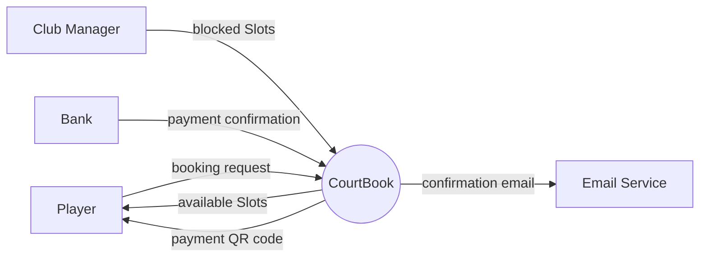
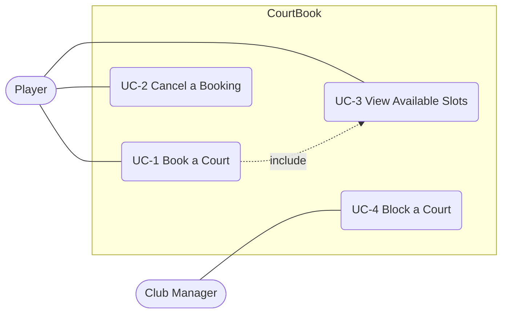
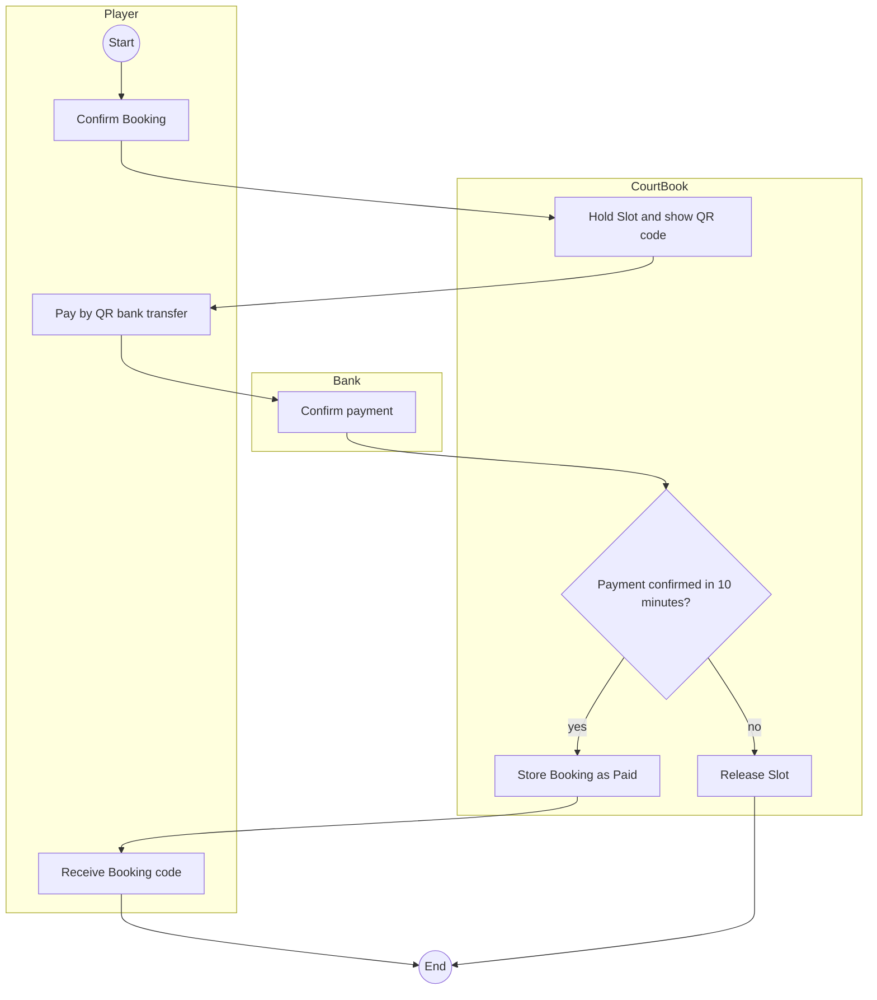
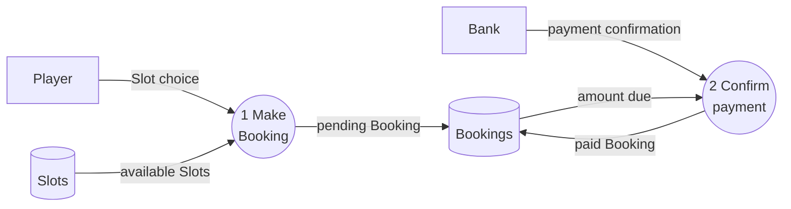
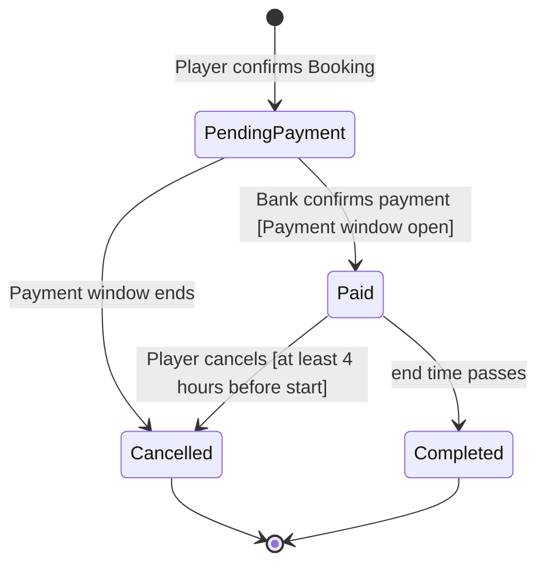
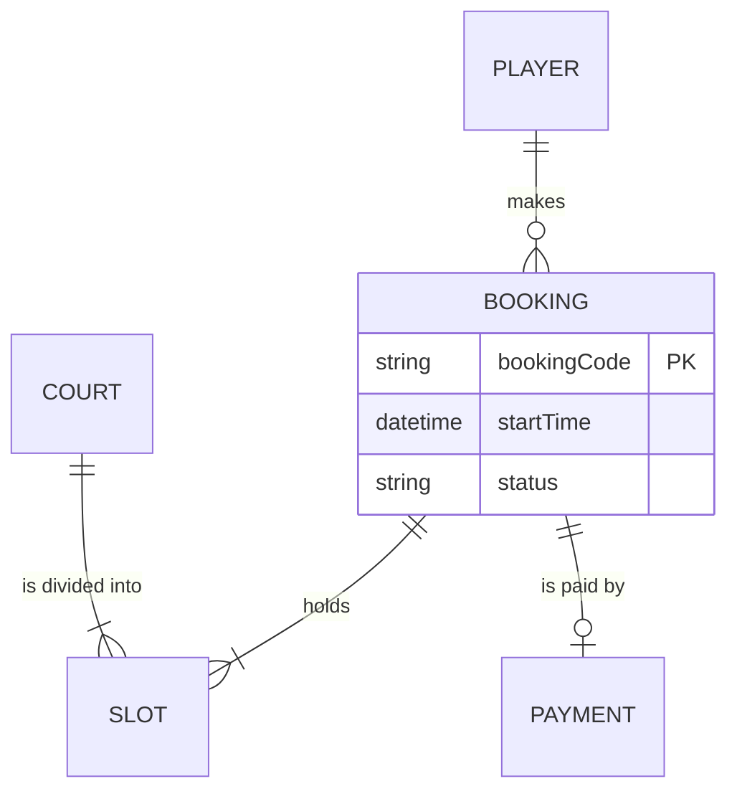
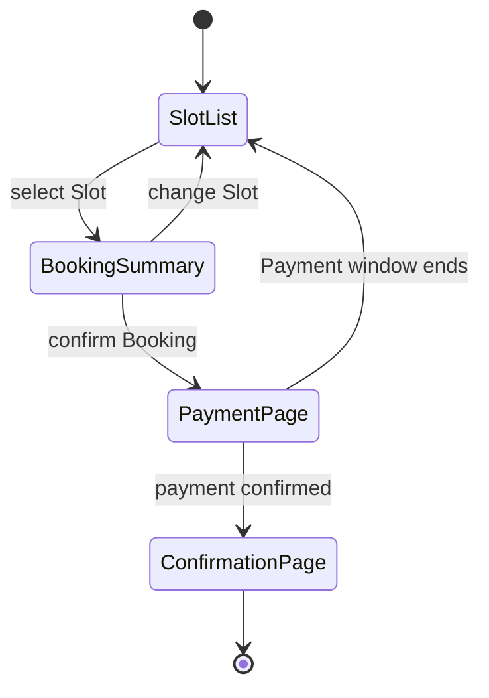
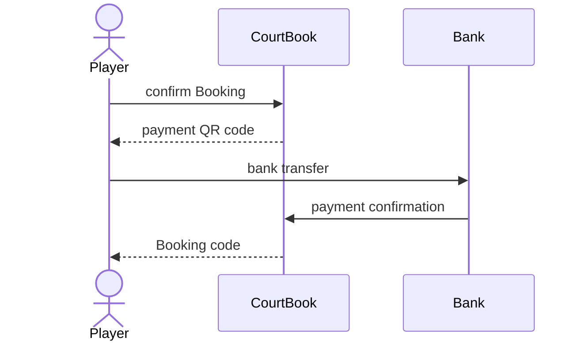
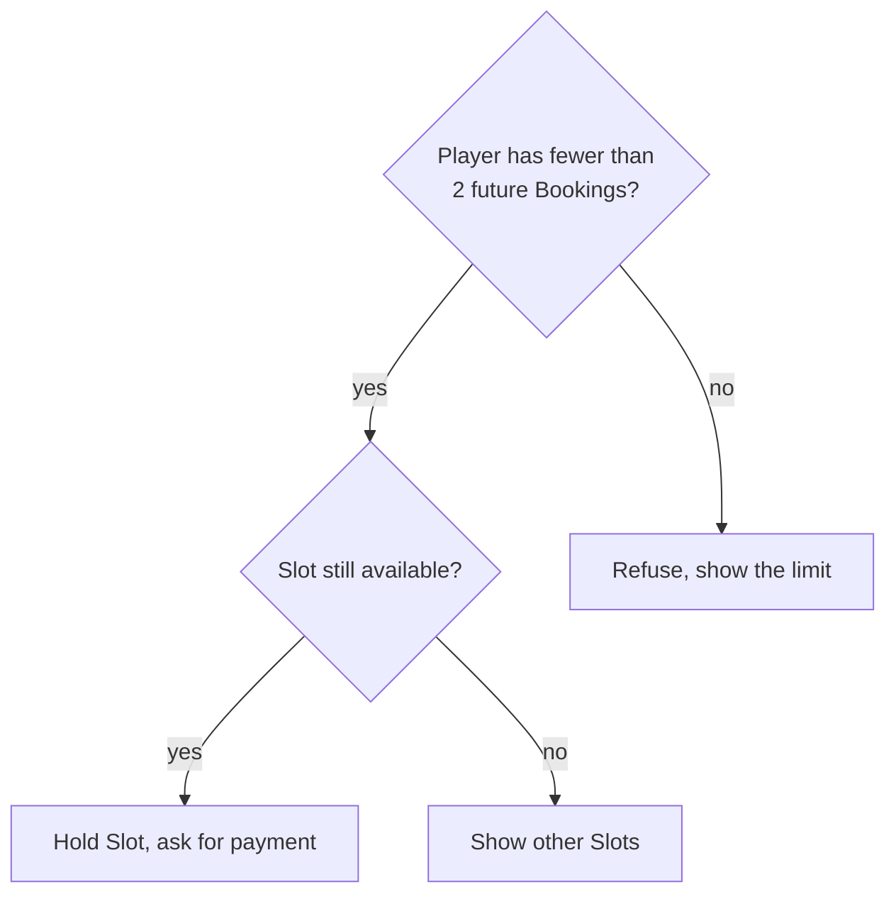
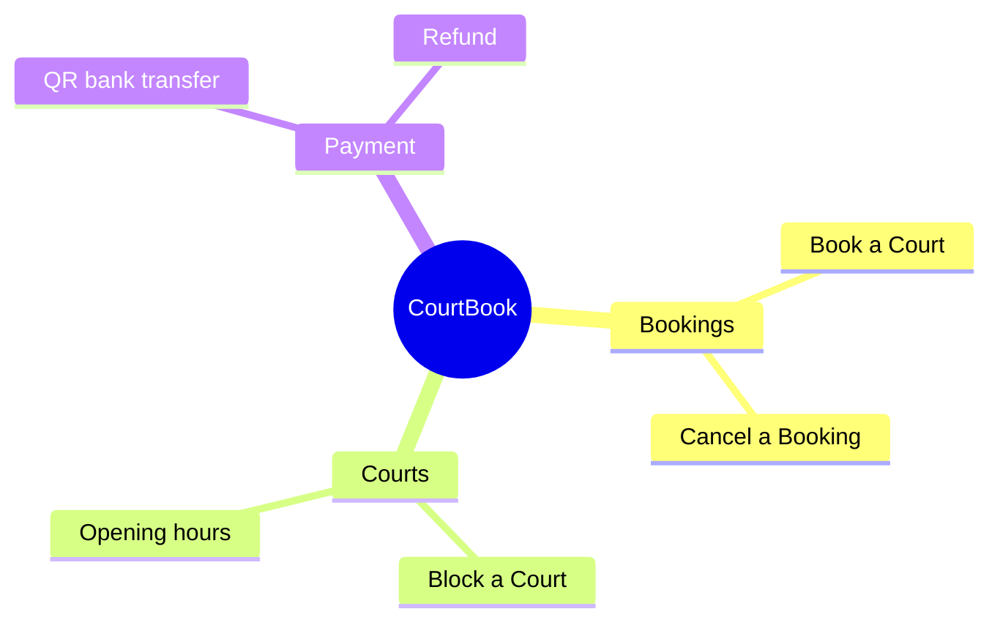

# Notation

One snippet per model, using CourtBook, a court booking web app for one badminton club. Copy the shape conventions and replace the content. Mermaid has no native context, use case, swimlane, or data flow diagram, so those four are drawn as flowcharts with fixed shapes.

## Context diagram

The system is one circle. External entities are rectangles. Arrows are data or control flows, labelled with a noun. Nothing inside the system is shown.

Figure 1. Context diagram for CourtBook, release 1.0
Key: circle = the system. Rectangle = external entity. Arrow = flow of data.

## Use case diagram

Actors sit outside the boundary. Use cases are rounded nodes inside it. Lines have no label. A dotted arrow marks `include` or `extend`.

Figure 2. Use case diagram for CourtBook (partial)
Key: stadium = actor. Rounded box = use case. Frame = system boundary.

## Swimlane diagram

One `subgraph` per role or system. Steps are rectangles, decisions are diamonds, start and end are circles. Every arrow that leaves a decision has a label.

Figure 3. Swimlane diagram: pay for a Booking
Key: frame = role. Rectangle = step. Diamond = decision.

## Data flow diagram

Processes are circles with a number. Data stores are cylinders. External entities are rectangles. Arrows carry data, labelled with a noun. Data moves between a store and a process, never store to store.

Figure 4. Level 0 data flow diagram (partial)
Key: circle = process. Cylinder = data store. Rectangle = external entity.

## State-transition diagram

One object per diagram. A transition label is `event [condition]`. Pair the diagram with a state table when the object has more than five states. In that table, rows and columns are states and a cell holds the event. An empty cell means "not allowed".

Figure 5. States of a Booking
Key: box = state. Arrow = allowed change, labelled with its cause.

## Entity-relationship diagram

Entity names are singular and upper case. Each relationship line has a verb. List only the attributes that the requirements mention. The full definitions belong in the data dictionary.

Figure 6. Entity-relationship diagram (partial)
Key: `||` exactly one. `o{` zero or more. `|{` one or more. `o|` zero or one.

## Dialog map

Each screen, dialog, or message is a state. A transition label is the user action or system event that causes the navigation.

Figure 7. Dialog map for UC-1 Book a Court
Key: box = screen or dialog. Arrow = navigation and its trigger.

## Sequence diagram

Figure 8. Payment by QR bank transfer
Key: solid arrow = request. Dashed arrow = response.

## Decision tree

Use it for two or three conditions. More than that: use a decision table.

Figure 9. Decision tree: accepting a Booking
Key: diamond = condition. Rectangle = outcome.

## Feature tree

Figure 10. Feature tree for CourtBook
Key: first level = feature (FE-n). Second level = sub-feature.

## Tables

**Decision table.** One column per rule, with conditions above and actions below. With n yes/no conditions there are at most 2^n columns: account for each one.

| Condition | 1 | 2 | 3 |
|---|---|---|---|
| Player has fewer than 2 future Bookings | Y | Y | N |
| Slot still available | Y | N | – |
| **Action** | | | |
| Hold Slot, ask for payment | X | | |
| Show other Slots | | X | |
| Refuse, show the limit | | | X |

**Event-response table.** One row per pair of event and system state.

| ID | Event | System state | Response |
|---|---|---|---|
| EV-1 | Payment window ends | Booking is Pending payment | Release the Slot, set Booking to Cancelled |

**CRUD matrix.** Rows are use cases and columns are entities. A cell holds C, R, U, or D. An entity that no use case creates, or that nothing reads, is a missing requirement.

| Use case | Booking | Slot | Payment |
|---|---|---|---|
| UC-1 Book a Court | C | R, U | C |
| UC-2 Cancel a Booking | U | U | R |
